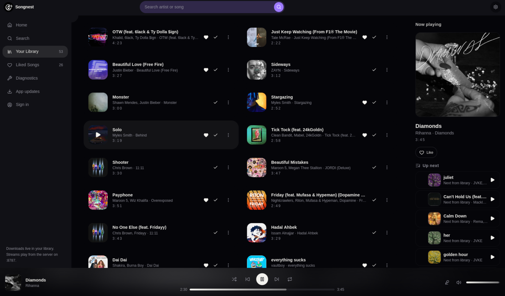
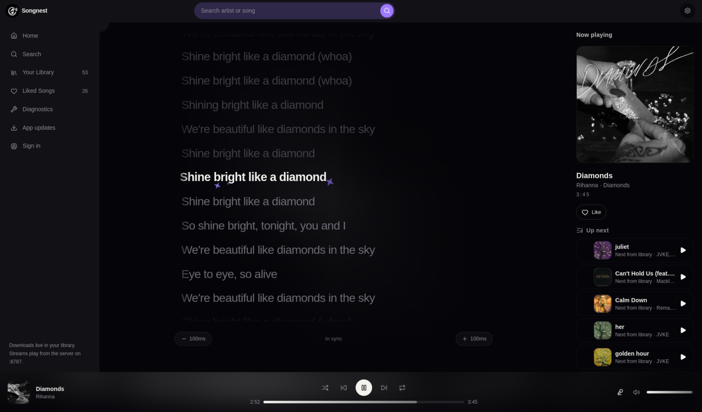
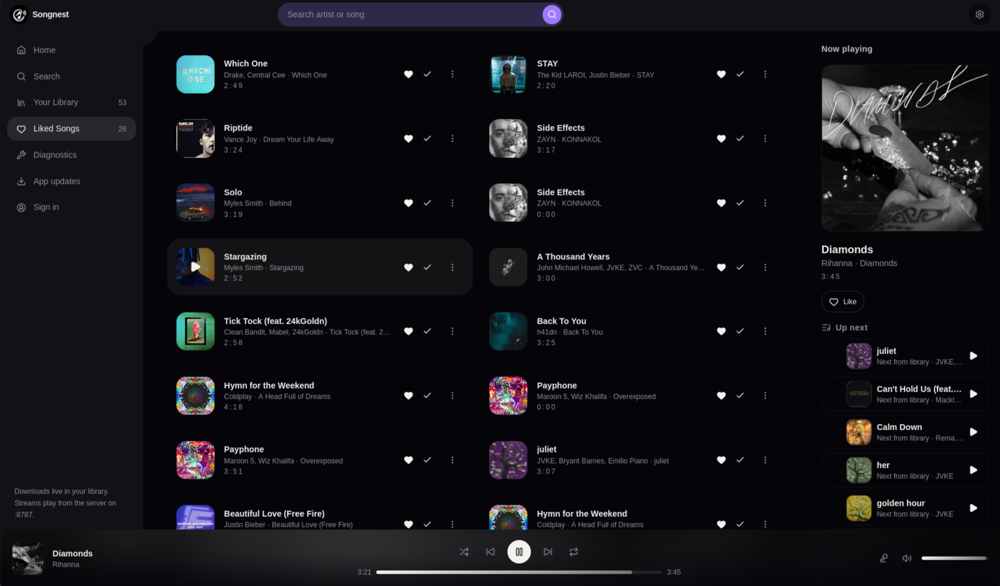

# Songnest

Songnest is a music library and player with a pluggable source system,
desktop-first, built with Tauri, Rust and React.

> **Status: released.** Desktop builds (macOS, Windows, Linux) and Android
> are ready to use. Android is the newest platform, so expect the odd rough
> edge there; report anything you hit in the community.

Join the [Songnest WhatsApp community](https://chat.whatsapp.com/COutxvPnS4J3W5vyDSeWxv)
for release announcements, new builds, and to report problems.

What works today:

- Metadata search, suggestions, and a local library with likes.
- Playback of saved tracks, plus proxied streaming for unsaved ones.
- A save-to-library queue (max 2 at a time) with request pacing and
  rate-limit handling, progress, and health reporting.
- Source health and diagnostics screen (backend versions, update status,
  cooldown state).
- Desktop app (Tauri) that spawns and manages the backend automatically.
- Background playback: native notification + lockscreen controls on
  Android (Media3), tray + close-to-tray with OS media keys on desktop.
- In-place Android updates through Android's own installer.
- Android builds ship as single-ABI APKs so they install on more devices.

Planned:

- Local-file import — planned.
- Loudness normalization — planned.
- Legal-source support — planned.

## Screenshots

Desktop library, likes, and lyrics:





## Quick start

Prerequisites: a recent Rust toolchain and Node.js. Optional, installed
and configured by you: `yt-dlp` and a JavaScript runtime (Deno 2.3+, or
Node.js 22+) for source challenge-solving.

```sh
# backend API + queue workers (http://127.0.0.1:8787)
cargo run -p songnest -- serve

# web frontend (dev)
cd web
npm install
npm run dev -- --port 1420 --strictPort

# type check + production frontend build
npm run build

# lint
npm run lint
```

Desktop app (builds the backend binary as a sidecar, then the app):

```sh
cd web
npm run desktop:sidecar
npm run desktop:build
```

Android (thin client; needs Java 17, the Android SDK/NDK, and
Python 3.11 for Chaquopy):

```sh
cd web
# If Chaquopy cannot find the host Python 3.11 automatically, point it at a
# real interpreter. A mise shim alone is not enough: mise must have a version
# selected, otherwise Chaquopy errors with "No version is set for shim".
export SONGNEST_BUILD_PYTHON=/absolute/path/to/python3.11
# A plain build makes a ~156 MB universal APK (all four ABIs). Some device
# installers (Transsion/HiOS on Android 15 Go) reject that as an invalid
# package; build a single-ABI APK instead — see the npm scripts below.
npm run android:build          # universal: armeabi-v7a + arm64-v8a + x86 + x86_64
npm run android:build:arm      # armeabi-v7a only (~69 MB, 32-bit phones)
npm run android:build:arm64    # arm64-v8a only (current 64-bit phones)
```

This builds signed release APKs and requires the Android release keystore.
Configure `web/src-tauri/gen/android/keystore.properties` locally (it is
gitignored), or set `ANDROID_KEY_ALIAS`, `ANDROID_KEY_PASSWORD`, and
`ANDROID_KEYSTORE_PATH`. The release build stops with an error if signing
credentials or the keystore are missing, rather than producing an APK that
cannot update the installed app.

Updates on Android use `PackageInstaller.Session`, which requires the
`REQUEST_INSTALL_PACKAGES` permission. Android still shows its own confirm
dialog — no app can install silently outside Google Play — but the download
and staging happen inside Songnest, so the user taps Install once instead of
hunting for the file in Downloads. The native side lives in
`web/src-tauri/plugins/installer` (Rust command + Kotlin plugin), mirroring
`plugins/player`.

Tests and checks:

```sh
cargo test --workspace
cargo clippy --workspace
cd web && npm run build
```

## Accounts & liked-songs sync

Optional self-hosted service (`crates/accounts`) for sign-up/sign-in and
syncing likes across devices. It handles **only** accounts and sync — never
music, downloads, or streaming. The app works fully without it.

```sh
# 1. Postgres (localhost only): create user + database
sudo -u postgres psql -c "CREATE USER songnest WITH PASSWORD '...';"
sudo -u postgres psql -c "CREATE DATABASE songnest OWNER songnest;"

# 2. Configure (never commit real secrets)
cp crates/accounts/.env.example crates/accounts/.env
# edit DATABASE_URL + SONGNEST_JWT_SECRET (min 32 random bytes)

# 3. Run (migrations apply automatically; default http://127.0.0.1:8788)
cargo run -p songnest-accounts
```

Postgres must listen on localhost only (`postgresql.conf`:
`listen_addresses = 'localhost'`, plus `pg_hba.conf` scram entries).

Environment variables (full list in `crates/accounts/.env.example`):

| Variable | Default | Purpose |
|---|---|---|
| `DATABASE_URL` | — (required) | Postgres connection |
| `DATABASE_URL_UNPOOLED` | unset | Optional direct Postgres URL for migrations; use Neon's unpooled URL when `DATABASE_URL` is pooled |
| `SONGNEST_JWT_SECRET` | — (required, ≥32 bytes) | Access-token HMAC secret |
| `SONGNEST_GITHUB_WEBHOOK_SECRET` | unset | Optional GitHub App webhook HMAC secret; set this to enable webhook verification |
| `SONGNEST_GITHUB_CLIENT_ID` / `SONGNEST_GITHUB_CLIENT_SECRET` | unset | GitHub App Client ID + secret for Login with GitHub (General page); unset disables `GET /auth/github/start` + `POST /auth/github/callback` |
| `SONGNEST_GOOGLE_CLIENT_ID` / `SONGNEST_GOOGLE_CLIENT_SECRET` | unset | Google OAuth client ID + secret for Login with Google (scopes `openid email profile`); unset disables `GET /auth/google/start` + `POST /auth/google/callback` |
| `SONGNEST_ACCOUNTS_BIND` | `127.0.0.1:8788` | Bind address (keep loopback) |
| `SONGNEST_ACCESS_TTL_SECS` | `900` | Access-token lifetime |
| `SONGNEST_REFRESH_TTL_SECS` | `2592000` | Refresh-token lifetime |
| `SONGNEST_CORS_ORIGINS` | Vite + Tauri origins | Exact-match CORS allowlist |
| `SONGNEST_AUTH_PER_MINUTE` | `10` | Per-IP auth rate limit |
| `SONGNEST_MAX_BODY_BYTES` | `1048576` | Max JSON body size |
| `SONGNEST_AVATARS_BUCKET` | `songnest-bucket` | Neon Object Storage bucket for profile pictures |
| `SONGNEST_AVATAR_MAX_BYTES` | `524288` | Max avatar upload size (must fit inside `SONGNEST_MAX_BODY_BYTES`) |
| `AWS_ACCESS_KEY_ID` / `AWS_SECRET_ACCESS_KEY` / `AWS_ENDPOINT_URL_S3` / `AWS_REGION` | — (avatars disabled when absent) | Branch storage credentials, injected by `neon deploy`; set the same four on Vercel production |

API reference (JSON; errors are `{ "error": "<showable message>" }`):

| Method & path | Auth | Description |
|---|---|---|
| `GET /health` | — | Liveness (pings the DB) |
| `POST /webhooks/github` | GitHub HMAC signature | Verifies GitHub deliveries; responds `pong` to `ping` and acknowledges other events without processing them |
| `POST /auth/signup` | — (rate-limited) | `{email, password}` → `201` + tokens |
| `POST /auth/login` | — (rate-limited) | `{email, password}` → `200` + tokens |
| `POST /auth/refresh` | — (rate-limited) | `{refresh_token}` → rotated pair |
| `POST /auth/logout` | — (rate-limited) | `{refresh_token}` → always `200` |
| `GET /auth/github/start?redirect_uri=<url>` | — (rate-limited) | `{authorize_url}` for Login with GitHub (needs `SONGNEST_GITHUB_CLIENT_ID`) |
| `POST /auth/github/callback` | — (rate-limited) | `{code, redirect_uri}` → `200` + tokens (find-or-create by GitHub ID, else link by verified email) |
| `POST /auth/github/device/start` | — | `{user_code, verification_uri, device_code, expires_in, interval}` — no callback URL needed (needs **Enable Device Flow** on the app) |
| `POST /auth/github/device/poll` | — | `{device_code}` → `202` `{pending}` until approved, `200` + tokens after, `400` when expired/denied |
| `GET /auth/google/start?redirect_uri=<url>` | — (rate-limited) | `{authorize_url}` for Login with Google (needs `SONGNEST_GOOGLE_CLIENT_ID`) |
| `POST /auth/google/callback` | — (rate-limited) | `{code, redirect_uri}` → `200` + tokens (find-or-create by Google sub, else link by verified email) |
| `GET /me` | Bearer | `{id, email, avatar_url, username}` (`avatar_url`/`username` null when unset) |
| `PUT /me/username` | Bearer | `{username}` → `200` updated profile; handle rules: 3–30 chars, letters/numbers/`_ . -`, case-insensitive unique forever |
| `PUT /me/email` | Bearer | `{email}` → `200` updated profile; must be valid and unused |
| `PUT /me/avatar` | Bearer | Raw JPEG/PNG/WebP/GIF body (≤512 KiB, magic-byte checked) → `200` `{avatar_url}`; stored in Neon Object Storage under a fresh key, old picture removed |
| `DELETE /me/avatar` | Bearer | Removes the picture → always `200` |
| `GET /sync/likes?since=<cursor>` | Bearer | Changes after cursor (incl. unlikes), oldest first, + new `cursor` |
| `POST /sync/likes` | Bearer | `{changes: [{track_id, liked, updated_at, title?, artist?, album?, cover?}]}` → `{cursor, applied, skipped}` (idempotent) |

Token pair shape: `{user: {id, email, username}, access_token, refresh_token,
expires_in}`.

Sync model: one row per `(user, track)`, `liked=false` rows are tombstones
so unlikes propagate; conflicts resolve last-write-wins on `updated_at`
(like wins exact ties); the server assigns a monotonic `version` cursor.
Only canonical `dz:<deezer_id>` likes sync — library rows without a Deezer
ID stay local-only (shown as "local only" in the UI).

App wiring: sign in from the sidebar (desktop) or Diagnostics → Songnest
account (mobile), or open `/#signin`. Tokens live in the OS credential
store (localStorage fallback in browser dev). Likes work offline and sync
on launch, login, change, and reconnect with backoff. The accounts base URL
defaults to `http://127.0.0.1:8788`, overridable via `VITE_ACCOUNTS_URL` or
the runtime `songnest-accounts-url` localStorage key. Profile pictures are
managed on `/#profile` (JPEG/PNG/WebP/GIF, ≤512 KiB) and stored in the
`songnest-bucket` Neon Object Storage bucket; `GET /me` returns the public
`avatar_url`.

Deployment (`deploy/`): `Dockerfile.accounts` (build on the ARM VM),
`songnest-accounts.service` (systemd), `Caddyfile` (HTTPS proxy), and
`backup-accounts-db.sh` (nightly `pg_dump` cron). Email verification and
password reset are TODOs (`POST /auth/...` reserved in code comments).
The GitHub App webhook URL is `https://api.songnest.smasduq.xyz/webhooks/github`.
Configure the same webhook secret in GitHub and `SONGNEST_GITHUB_WEBHOOK_SECRET`;
the endpoint currently acknowledges events but only handles the `ping` response.

The `songnest` Vercel project is rooted at `crates/accounts` and serves the same
Axum API as a Rust Function. Its `vercel.json` skips Git-triggered deployments;
`.github/workflows/accounts.yml` runs checks and deploys production only when a
GitHub Release is published. Configure the GitHub Actions secrets
`VERCEL_TOKEN`, `VERCEL_ORG_ID`, and `VERCEL_ACCOUNTS_PROJECT_ID` (separate
from the download site's `VERCEL_PROJECT_ID`), and set the Vercel production
environment variables `DATABASE_URL`, `SONGNEST_JWT_SECRET`, and
`SONGNEST_GITHUB_WEBHOOK_SECRET`; for Neon, also set `DATABASE_URL_UNPOOLED`
to the direct connection URL used by migrations. The app's `DATABASE_URL`
should be Neon's pooled connection URL. Both must be reachable from Vercel.

Known limitations: sync trusts device clocks for `updated_at` (skewed
clocks can misorder concurrent two-device edits); the per-IP rate limiter
sees the proxy's loopback IP behind Caddy (per-user throttling is a TODO).

## How it works

- Track metadata comes from a public catalog API.
- A pluggable source layer matches catalog entries to playable audio,
  caches matches and stream URLs, and keeps a local SQLite library.
- Saved tracks live as tagged audio files in the data directory; the
  bundled web UI talks to the local server over HTTP.
- `yt-dlp`, when used, is an optional separate tool installed and
  configured by the user. It is not bundled with Songnest.

## Responsible use

Songnest does not host, distribute, or provide any music. It is a player
and library manager. Users are solely responsible for complying with
copyright law and the terms of any service they connect to, and for the
source of any files they use. Prefer sources with licenses that allow
saving copies (Creative Commons catalogs, music you own).

## Not affiliated

Songnest is not affiliated with or endorsed by any streaming or video
service.

## Contributing

See [CONTRIBUTING.md](CONTRIBUTING.md). Please follow the
[Code of Conduct](CODE_OF_CONDUCT.md). Report security issues privately
as described in [SECURITY.md](SECURITY.md).

## License

Licensed under either of [MIT](LICENSE-MIT) or
[Apache-2.0](LICENSE-APACHE), at your option. Third-party Rust
dependency licenses are listed in
[THIRD_PARTY_LICENSES.md](THIRD_PARTY_LICENSES.md).
