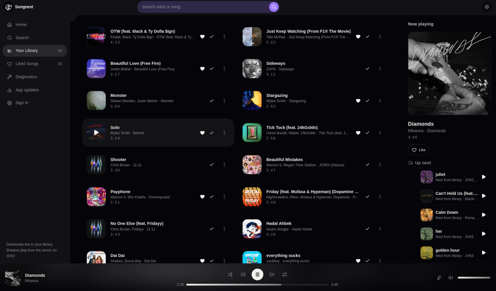
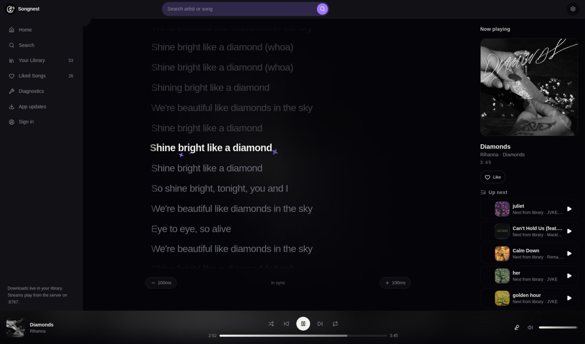
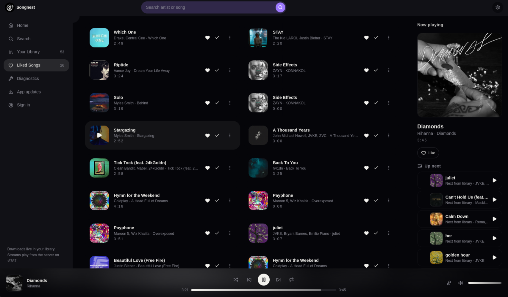

# Songnest 

Songnest is a music player and library app you can run on your PC or phone. It lets you search for songs, save them, and play them — all from one place.


Got questions or want to report a bug? Join the [Songnest WhatsApp community](https://chat.whatsapp.com/COutxvPnS4J3W5vyDSeWxv).

## What it can do

- 🔍 Search for songs and get suggestions
- ❤️ Like songs and build your own library
- ▶️ Play saved tracks or stream ones you haven't saved yet
- 📥 Download queue — saves up to 2 songs at a time
- 📱 Android: lockscreen controls, background playback, in-app updates
- 🖥️ Desktop: system tray, media keys, close-to-tray

## Coming soon

- Import Spotify playlists
- Import your own local music files
- Loudness normalization (so songs don't blast your ears)
- Support for legal streaming sources

## Screenshots

Desktop library, likes, and lyrics:





## Running it yourself

You'll need **Rust** and **Node.js** installed. Then:

```sh
# Start the backend
cargo run -p songnest -- serve

# Start the frontend (open http://localhost:1420)
cd web
npm install
npm run dev -- --port 1420 --strictPort
```

**Build for desktop:**

```sh
cd web
npm run desktop:sidecar
npm run desktop:build
```

**Build for Android** (you'll also need Java 17, Android SDK/NDK, and Python 3.11):

```sh
cd web
npm run android:build         # all devices
npm run android:build:arm64   # 64-bit phones (most modern phones)
npm run android:build:arm     # 32-bit phones
```

**Run tests:**

```sh
cargo test --workspace
cargo clippy --workspace
cd web && npm run build
```

## Accounts & likes sync (optional)

You can run a small server to sync your liked songs across devices. It only handles accounts and sync — not music itself. The app works fine without it.

```sh
# 1. Set up a Postgres database
sudo -u postgres psql -c "CREATE USER songnest WITH PASSWORD '...';"
sudo -u postgres psql -c "CREATE DATABASE songnest OWNER songnest;"

# 2. Set up config
cp crates/accounts/.env.example crates/accounts/.env
# edit DATABASE_URL and SONGNEST_JWT_SECRET

# 3. Run it (starts at http://127.0.0.1:8788)
cargo run -p songnest-accounts
```

## How it works

1. Song info (title, artist, cover art) comes from a public catalog API.
2. A plugin system finds where to actually play or download each song.
3. Saved songs are stored as audio files on your device.
4. The app talks to a local server running in the background.


## Heads up — legal stuff

Songnest doesn't host or distribute any music. It's just a player. **You're responsible** for making sure you're allowed to save or play whatever you're accessing. Stick to Creative Commons music or stuff you own.

Songnest is also not affiliated with any streaming service.

## Contributing

Check out [CONTRIBUTING.md](CONTRIBUTING.md) and the [Code of Conduct](CODE_OF_CONDUCT.md). For security issues, see [SECURITY.md](SECURITY.md).

## License

[MIT](LICENSE-MIT) or [Apache-2.0](LICENSE-APACHE) — your pick. Third-party licenses are in [THIRD_PARTY_LICENSES.md](THIRD_PARTY_LICENSES.md).
